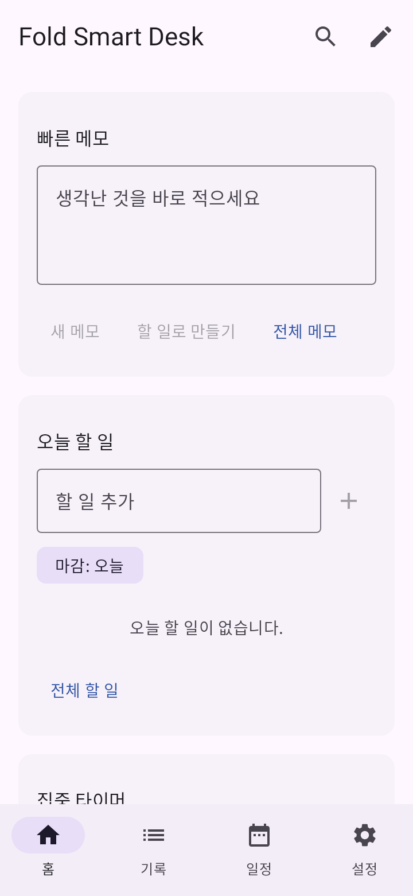
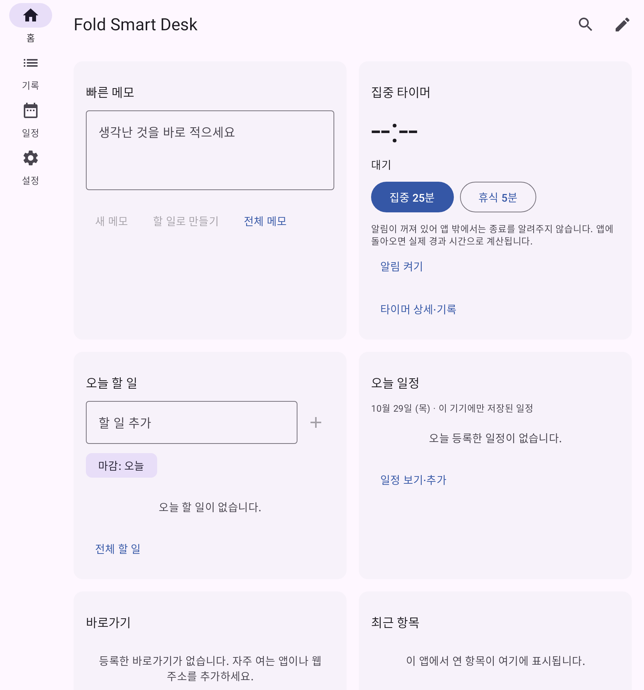

# Fold Smart Desk (7번 폴드 스마트 대시보드)

접으면 메모와 빠른 실행, 펼치면 할 일·일정·집중 타이머를 한눈에 보는 **독립 Android 앱**입니다.
다른 다섯 앱, PC, 서버, 계정, API 키 없이 동작합니다.

- 패키지: `com.miu.fold.dashboard` · versionName `0.1.0` (versionCode 1)
- 대상: Android 11(API 30) 이상, 폴드형 기기 우선 · UI 한국어
- 현재 단계: **0단계 + 1단계 완료(기기 미검증)**, 2~4단계 일부 선구현 — 자세한 상태는 [docs/TASKS.md](docs/TASKS.md)

## 지금 실제로 되는 것

| 영역 | 구현 |
|---|---|
| 홈 | 카드 6종(빠른 메모·오늘 할 일·집중 타이머·바로가기·오늘 일정·최근 항목), 창 너비에 따라 1/2/3열 |
| 배치 | 좁은 화면/넓은 화면 배치 **각각 따로 저장**. 편집 모드(길게 누르기 또는 연필 버튼) → 앞으로/뒤로/위로/아래로, 1~3열 크기, 숨기기, 카드 추가·삭제 → 저장/취소, 선택한 배치만 초기화 |
| 메모 | 제목 없이 바로 작성(첫 줄이 제안 제목), 500ms 자동 저장, 저장 중/저장됨/저장 실패 표시와 재시도, 고정, 태그, 휴지통·복원·영구 삭제(확인), 텍스트 공유, 다른 앱에서 공유받은 텍스트를 미리보기 후 메모로 저장, 메모→할 일(원본 메모 유지·참조) |
| 할 일 | 오늘/예정/기한 지남/날짜 없음/완료 보기, 날짜만 있는 마감(LocalDate), 우선순위, 수동 순서, 완료 되돌리기, 삭제 되돌리기 |
| 집중 타이머 | 25분 집중/5분 휴식/직접 지정, 시작·일시정지·재개·종료·다시 시작, 세션 목적·연결 할 일, 앱을 나갔다 와도 실제 경과로 복원, 시스템 시각 변경 무관, 재부팅 시 '중단됨' + 남은 시간 재개, 완료/취소 구분 기록(세션당 1건) |
| 바로가기 | 웹(https 기본, 위험 스킴·토큰 포함 URL 거절), 설치된 앱(런처 앱만 조회), 앱 안 화면. 실행 불가 시 웹 대체/수정/삭제 안내 |
| 일정 | 이 앱에만 저장되는 로컬 일정(종일/시간 지정 분리, 종료<시작 거절), 날짜 이동, 이후 30일 목록 |
| 검색·최근 | 메모·할 일·일정·바로가기만 검색(유형 필터), 이 앱에서 연 항목만 최근 기록, 최근 목록 내용 숨김 옵션 |
| 설정 | 테마(시스템/밝게/어둡게), 타이머 시간, 배치 초기화, JSON 백업 내보내기/가져오기(새 데이터로 추가 기본, 전체 교체는 사전 백업+확인) |

**아직 없는 것**: 앱 밖 타이머 종료 알림, 드래그 이동, 월 달력 보기, 힌지(폴딩 정보) 회피, 홈 위젯, 다른 앱 연동 카드, 워크스페이스, 반복 할 일. → [docs/TASKS.md](docs/TASKS.md)

## 빌드·설치

요구: JDK 21(툴체인), Android SDK Platform 36 + Build-Tools 36.0.0.

```bash
cd 07-fold-smart-desk/android
echo "sdk.dir=/path/to/android-sdk" > local.properties   # 처음 한 번
./gradlew :app:testDebugUnitTest      # JVM 단위·Robolectric UI 테스트
./gradlew :app:lintDebug              # Lint
./gradlew :app:assembleDebug          # → app/build/outputs/apk/debug/app-debug.apk
adb install -r app/build/outputs/apk/debug/app-debug.apk
```

디버그 서명 APK입니다. 스토어 배포용 서명·릴리스 빌드는 아직 설정하지 않았습니다.

**제거**: 기기 설정 → 앱 → Fold Smart Desk → 제거. 앱 데이터(메모·할 일 등)도 함께 지워지므로 먼저 설정 → 백업 내보내기를 하세요. 클라우드 자동 백업은 꺼져 있습니다.

## 미리보기(JVM 렌더링, 실기기 화면 아님)

| 접힘 360dp | 펼침 840dp |
|---|---|
|  |  |

## 문서

[SPEC](docs/SPEC.md) · [TASKS](docs/TASKS.md) · [PROGRESS](docs/PROGRESS.md) · [DECISIONS](docs/DECISIONS.md) · [DATA_MODEL](docs/DATA_MODEL.md) · [TEST_REPORT](docs/TEST_REPORT.md) · [SECURITY](docs/SECURITY.md)
