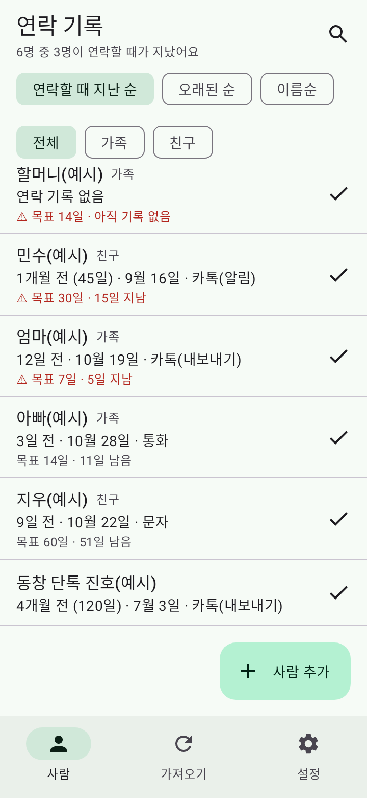
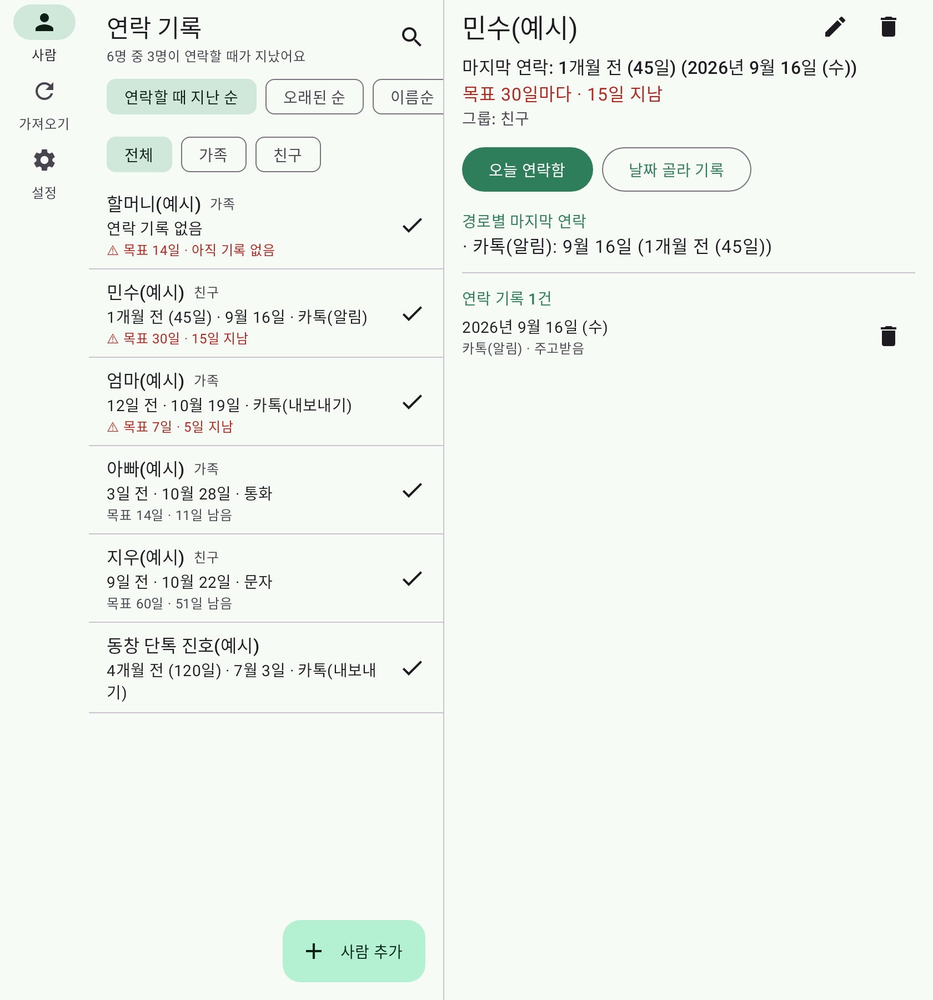
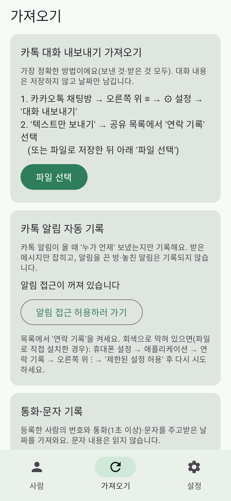

# 연락 기록 (Last Contact) — 08

친구·가족과 **마지막으로 연락한 날짜**를 기록하고, 오래 연락하지 않은 사람을 알려주는 Android 앱입니다. 본인 폰에 직접 설치해서 씁니다(스토어 배포 없음).

- 패키지 `com.miu.lastcontact` · 0.1.0 (versionCode 1) · Android 11(API 30) 이상 · 한국어
- **카톡 대화·문자 내용은 저장하지 않고 '누구와 언제'만** 남깁니다. 인터넷 권한 없음.
- 상태: 기능 구현 완료, **실기기 미검증** — [docs/TASKS.md](docs/TASKS.md)

## 기록 방법 4가지

| 방법 | 어떻게 | 기본 |
|---|---|---|
| 직접 기록 | 목록의 ✓ 또는 상세의 '오늘 연락함', '날짜 골라 기록'(메모 가능) | 항상 |
| 카톡 대화 내보내기 | 카톡 채팅방 ≡ → ⚙ → 대화 내보내기 → 텍스트만 → '연락 기록'으로 공유(또는 파일 선택). 보낸 사람마다 나/사람/새 사람/무시 고르기 | 항상 |
| 카톡 알림 자동 기록 | 가져오기 탭 → 알림 접근 허용. 카톡 알림의 보낸 사람·시각 기록, 모르는 이름은 '미확인 이름'에서 연결 | 꺼짐 |
| 통화·문자 | 가져오기 탭 → 권한 허용. 등록한 번호와 통화(1초 이상)·문자 날짜 | 꺼짐 |

카카오 공식 API에는 대화 기록을 읽는 기능이 없어 내보내기 파일과 알림을 씁니다. 알림 방식은 **받은 메시지만**, 알림을 끈 방은 기록되지 않습니다.

그 밖: 사람별 목표 주기(1주·2주·1달·3달·직접)와 '연락할 때 지난 순' 정렬, 그룹·검색, 매일 알림(목표를 넘긴 사람이 있을 때), JSON 백업·복원, 폴드 펼침·태블릿 2패널.

## 미리보기(JVM 렌더링, 예시 데이터)

| 목록 360dp | 펼침 840dp | 가져오기 |
|---|---|---|
|  |  |  |

## 폰에서 처음 켤 때

1. 설치: APK를 폰에 옮겨 설치(출처를 알 수 없는 앱 허용 필요) 또는 아래 PC 스크립트.
2. 카톡 알림 자동 기록을 켜려는데 '알림 접근'이 회색이면: 설정 → 애플리케이션 → 연락 기록 → ⋮ → **제한된 설정 허용** (파일로 직접 설치한 앱에 대한 Android 13+ 보호 장치).
3. 설정 → '내 카톡 이름'을 적어 두면 내보내기 가져오기에서 '나'가 자동 선택됩니다.

## PC에서 빌드·실기기 테스트(Windows)

저장소 전체를 둔 폴더에서 `08-last-contact\tools\device-test.bat` 더블클릭(폰은 USB 디버깅 연결). 빌드 → 실기기 자동 테스트(별도 테스트 앱 '연락기록 테스트용', 실제 자료 안 건드림) → 설치·실행·캡처 → `docs\device-results\` 보고서. 자세히: [docs/DEVICE_TEST.md](docs/DEVICE_TEST.md)

```bash
cd 08-last-contact/android
./gradlew :app:testDebugUnitTest :app:lintDebug :app:assembleDebug :app:assembleRelease
./gradlew :app:connectedDeviceTestAndroidTest   # 연결된 폰
```

**지우기 전에** 설정 → 백업 내보내기(앱을 지우면 기록도 지워집니다).

문서: [SPEC](docs/SPEC.md) · [TASKS](docs/TASKS.md) · [PROGRESS](docs/PROGRESS.md) · [DECISIONS](docs/DECISIONS.md) · [DATA_MODEL](docs/DATA_MODEL.md) · [TEST_REPORT](docs/TEST_REPORT.md) · [SECURITY](docs/SECURITY.md) · [DEVICE_TEST](docs/DEVICE_TEST.md)
