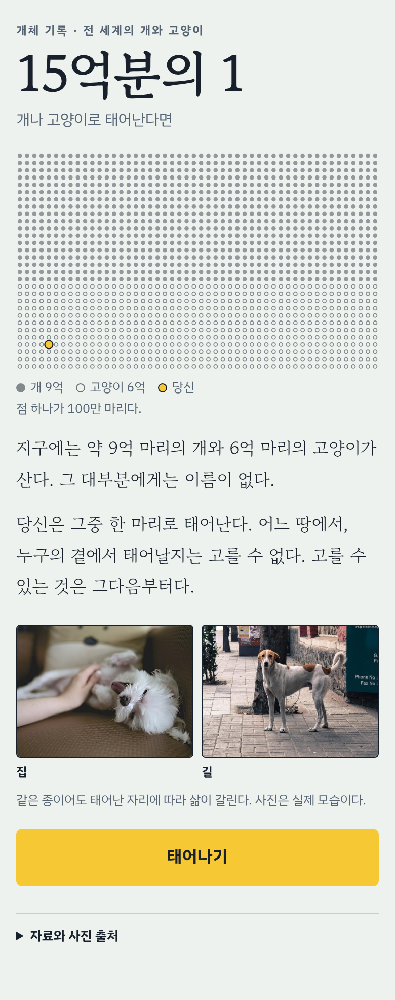
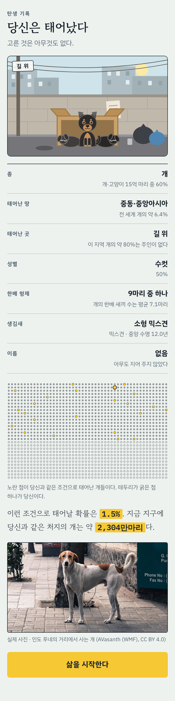
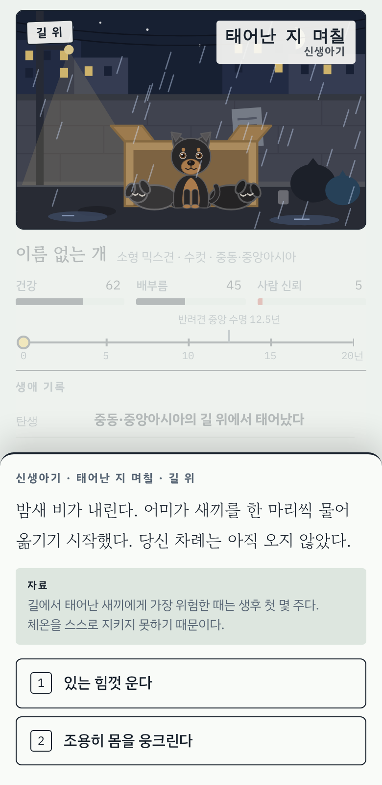
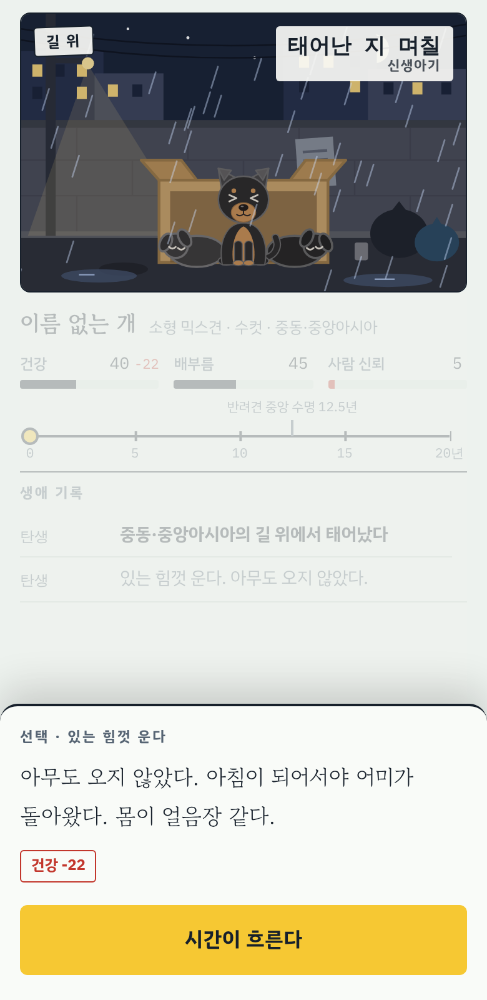
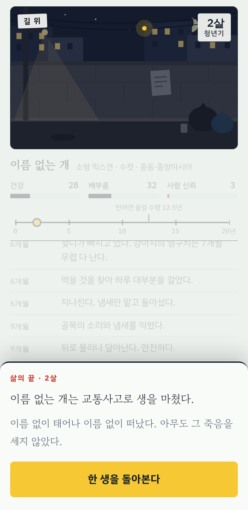
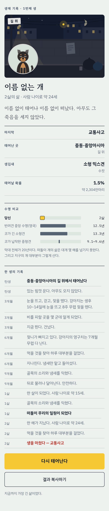

# 15억분의 1

지구의 개와 고양이 약 15억 마리 중 한 마리로 태어나 살아가는 통계 기반 생애 시뮬레이션 웹 게임.

`index.html` 한 파일로 동작한다. 브라우저에서 열거나 정적 호스팅(GitHub Pages 등)에 올리면 된다.

출생 확률과 사건 결과는 공개 통계(개체 수 추정, 품종별 수명, 보호소 통계, 한국 유기동물 실태조사 등)를 바탕으로 한 근사 모형이며, 출처는 게임 첫 화면에 있다.

## 앱으로 설치 (PWA)

HTTPS로 배포하면 브라우저에서 그대로 플레이할 수 있고, 휴대폰이나 PC에서 홈 화면에 추가하면 앱처럼 전체 화면으로 실행된다. 한 번 열고 나면 오프라인에서도 동작한다.

관련 파일: `manifest.webmanifest`, `sw.js`, `icon-192.png`, `icon-512.png`

## 화면

| 시작 | 탄생 | 선택지 | 결과 | 마지막 | 생애 기록 |
|---|---|---|---|---|---|
|  |  |  |  |  |  |

삽화는 코드(SVG)로 그렸고, 실제 사진의 출처와 라이선스는 `img/CREDITS.md`에 있다.
